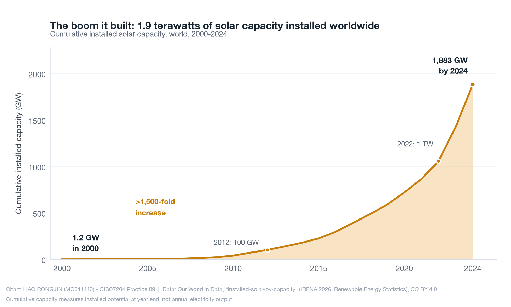

# Solar PV: A Half-Century Cost Collapse and the Global Capacity Boom

**Author:** Liao Rongjin (MC641440) — University of Macau, CISC7204 *Data Science and Data Visualization*

## The problem (research question)

How much have solar photovoltaic (PV) module costs fallen since 1975, and how has global installed solar capacity grown in response? This small project answers that question with two clean, reproducible figures built from public data.




## Dataset source and usage permissions

Both datasets come from **Our World in Data (OWID)**, which publishes its data under the **Creative Commons BY 4.0 (CC BY 4.0)** licence: free to share and adapt for any purpose with attribution. The raw CSVs are included in [`data/`](data/) (downloaded on 5 October 2026), so no external download is needed to rerun the analysis.

| File | Source | Underlying producer |
|---|---|---|
| `data/solar-pv-prices.csv` | [ourworldindata.org/grapher/solar-pv-prices](https://ourworldindata.org/grapher/solar-pv-prices) | Nemet (2009); Farmer & Lafond (2016); IRENA |
| `data/installed-solar-pv-capacity.csv` | [ourworldindata.org/grapher/installed-solar-pv-capacity](https://ourworldindata.org/grapher/installed-solar-pv-capacity) | IRENA, *Renewable Energy Statistics* |

Prices are adjusted for inflation (constant 2025 US$). No personal data, API keys, passwords, or restricted material is included in this repository.

## Methods and tools

- **Python 3** with **pandas** for loading and filtering the two time series (keeping the `World` aggregate rows).
- **Matplotlib** for two static charts that follow a single visual style (one amber accent for solar, light gridlines, direct labelling instead of legends).
- Descriptive statistics only — a percentage change from the first to the last observation, and per-decade milestone values. No modelling is involved, so no train/test split or tuning is needed for this question.

## Key findings

1. **Module prices collapsed by 99.8%.** A solar PV module cost about **$132 per watt in 1975** and about **$0.27 per watt in 2024** (constant 2025 US$). Because the series spans several orders of magnitude, the price chart uses a **logarithmic y-axis** so equal vertical distances represent equal percentage changes.
2. **Deployment grew more than 1,500-fold.** Cumulative installed capacity rose from **1.2 GW in 2000** to **1,883 GW at the end of 2024** (≈1.9 terawatts). The world passed the **1 terawatt mark in 2022** (1,058 GW).
3. **The growth is not slowing.** The chart's slope shows year-on-year additions accelerating, with the 2022–2024 period alone adding more capacity than the entire previous history.

**One limitation:** installed capacity measures the *stock of installed potential at year end*, not the electricity actually generated — output depends on capacity factors, weather, and grid operation. World totals also hide large differences between countries, so this analysis describes the global trend, not any single market.

## How to run the analysis

```bash
# 1. (optional) create and activate a virtual environment
python3 -m venv .venv
source .venv/bin/activate        # Windows: .venv\Scripts\activate

# 2. install the dependencies
pip install -r requirements.txt

# 3a. run it interactively
jupyter notebook solar_analysis.ipynb

# 3b. or run it as a script (recreates both figures in figures/)
python solar_analysis.py
```

Both routes print the key statistics and write the two figures into `figures/`. The notebook is committed with its outputs already executed, so it can also be read directly on GitHub without running anything.

## Repository structure

```
data-science-project/
├── README.md                     # this file
├── solar_analysis.ipynb          # executed notebook: full analysis with outputs
├── solar_analysis.py             # the same analysis as a standalone script
├── requirements.txt              # pandas + matplotlib (+ jupyter)
├── data/                         # raw CSVs from Our World in Data (CC BY 4.0)
│   ├── solar-pv-prices.csv
│   └── installed-solar-pv-capacity.csv
└── figures/                      # the two figures (PNG, 200 dpi)
    ├── fig1_solar_cost_collapse.png
    └── fig2_solar_capacity_boom.png
```

## Data attribution

Our World in Data. (2026). *Solar photovoltaic module prices* [Data set]. Based on Nemet (2009), Farmer & Lafond (2016) and IRENA. https://ourworldindata.org/grapher/solar-pv-prices

Our World in Data. (2026). *Installed solar energy capacity* [Data set]. Based on IRENA, *Renewable Energy Statistics*. https://ourworldindata.org/grapher/installed-solar-pv-capacity

Data licence: [CC BY 4.0](https://creativecommons.org/licenses/by/4.0/). Figures in this repository: © 2026 Liao Rongjin, released under the same licence.
